# DrawZone

A real-time multiplayer drawing and guessing game for the browser. Create a private room, share the 5-character room code, take turns drawing a secret word while the other players guess it.

## Live Demo

[Play DrawZone](https://drawzone.onrender.com)

> **Honest status:** the server game logic is covered by 39 automated tests that pass (run against an in-memory fake of Socket.IO). The author manually verified the deployed core multiplayer flow in two browser tabs. The client tests and real-socket integration tests have not been run. See `docs/TESTING.md` for test commands.

## Features

- Create a room / join with a room code (Socket.IO, with acknowledgments and timeouts)
- Lobby with host badge, host transfer, copy-code button, 2 to 8 players
- Word selection (3 options, only the drawer sees them, 15 s timeout with auto-pick)
- Shared canvas: colors, 3 brush sizes, eraser, clear; mouse, pen and touch
- Server-authoritative timer, scoring, drawer rotation, round summary, final ranking, rematch
- Validation, rate limiting and room isolation on the server
- Responsive layout, keyboard focus styles, reduced-motion support

## Technology

| Part | Technology |
|---|---|
| Frontend | React 18, TypeScript, Vite, plain CSS, socket.io-client |
| Backend | Node.js, Express, Socket.IO (JavaScript, CommonJS) |
| State | In-memory (no database) |
| Tests | `node:test` (server), Vitest (client utilities) |

## Prerequisites

- Node.js 18 or newer (`node -v`)
- npm (use `npm.cmd` in Windows PowerShell if `npm` is blocked)

## Install and run (Windows PowerShell)

Use **two terminals** (VS Code: Terminal > New Terminal, then the `+` button).

Terminal 1, backend:

```powershell
cd C:\game_project\server
npm.cmd install
node server.js
```

Expected: `DrawZone server running at http://localhost:3001`

Terminal 2, frontend:

```powershell
cd C:\game_project\client
npm.cmd install
npm.cmd run dev
```

Open the URL that Vite prints (usually `http://localhost:5173`; if 5173 is busy Vite uses 5174 and prints it).

Keep both terminals open while playing. Start each server only once.

## Test multiplayer

1. Open the app in two browser tabs (or one normal and one private window).
2. Tab 1: nickname `Asha` > Create room. Note the code.
3. Tab 2: nickname `Ravi`, enter the code > Join room.
4. Tab 1 (host): Start game. The drawer picks a word, draws, the other tab guesses.

To play from a phone on the same Wi-Fi: open `http://<your-laptop-IP>:5173` (the client automatically uses port 3001 on the same computer). Allow Node.js through the Windows firewall if asked.

## Scripts

| Folder | Command | Purpose |
|---|---|---|
| server | `node server.js` / `npm.cmd start` | start backend |
| server | `npm.cmd run dev` | start with auto-restart (`node --watch`) |
| server | `npm.cmd test` | all tests (integration needs `npm install` first) |
| server | `npm.cmd run test:unit` | tests that need no network or extra packages |
| client | `npm.cmd run dev` | start Vite dev server |
| client | `npm.cmd run build` | type-check and production build |
| client | `npm.cmd run typecheck` | TypeScript check only |
| client | `npm.cmd test` | Vitest (validation utilities) |

## Configuration

See `server/.env.example` and `client/.env.example`. Defaults need no configuration. Game rules (players, rounds, time) are in `server/src/config.js`.

## Common errors

See `docs/SETUP_AND_TROUBLESHOOTING.md` (`EADDRINUSE`, npm JSON errors, PowerShell blocking npm, Vite port 5174, "Server unavailable").

## Documentation

`docs/` contains the project report, architecture, workflow, socket event reference, state/data notes, testing, user guide, setup guide and viva preparation.

## Screenshots

<details>
<summary>View all 11 screenshots</summary>

### Room entry

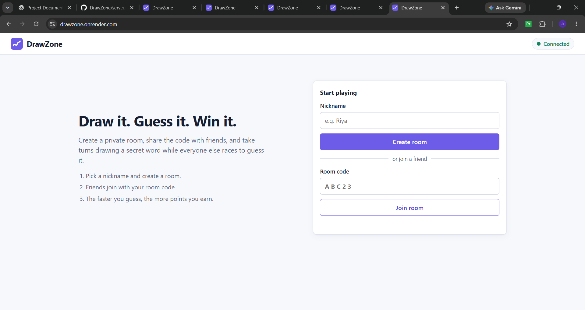

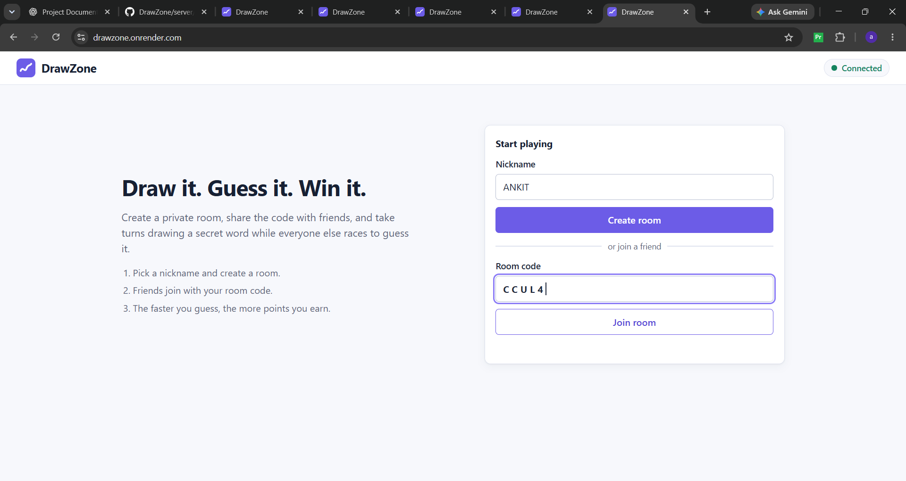

### Gameplay

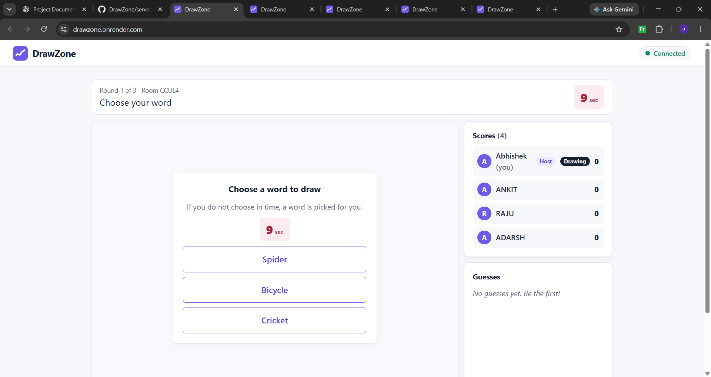

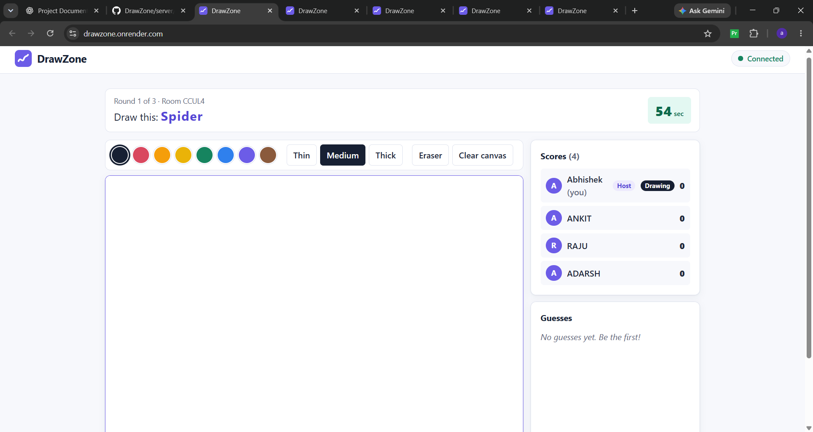

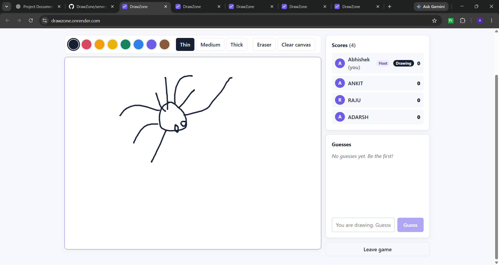

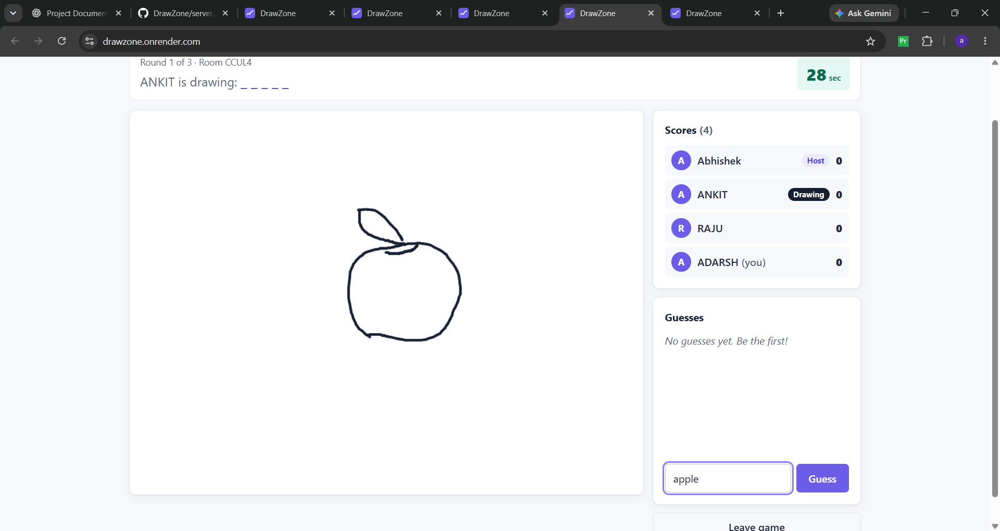

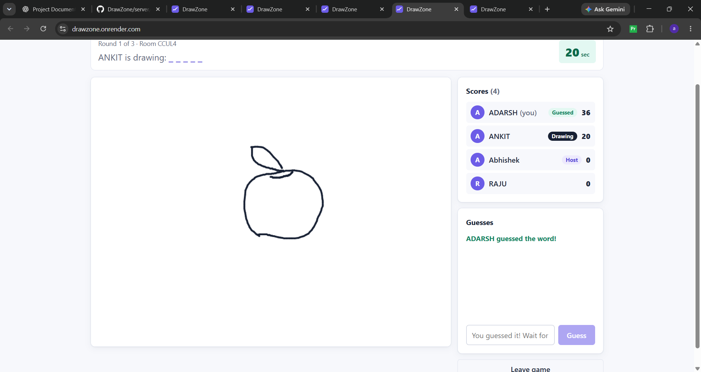

### Round and game results

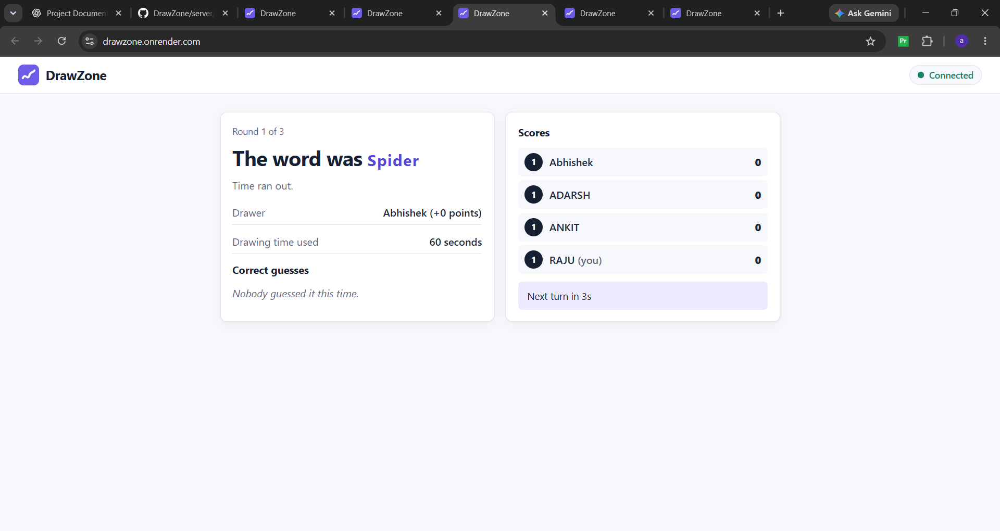

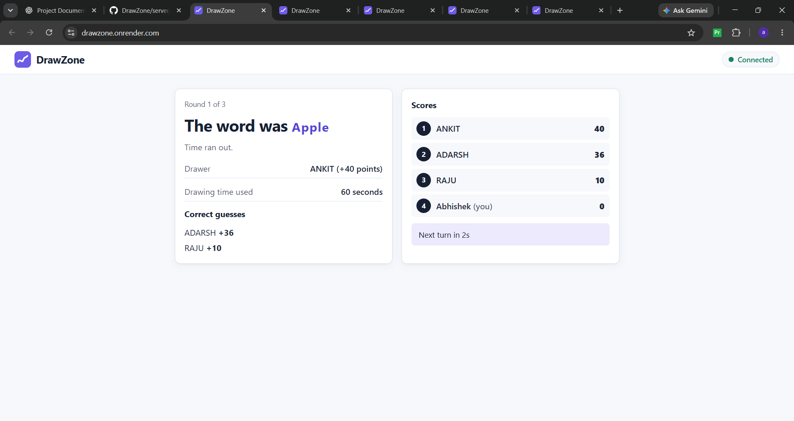

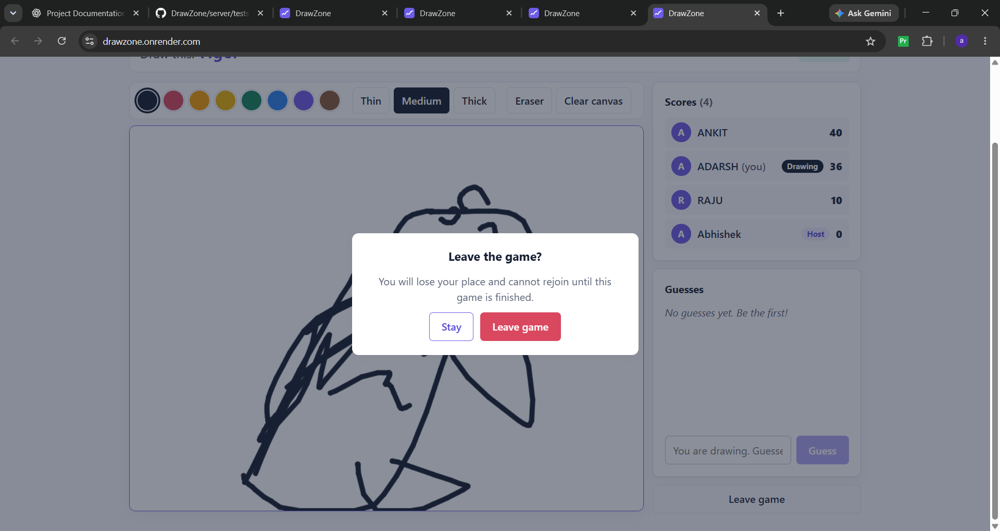

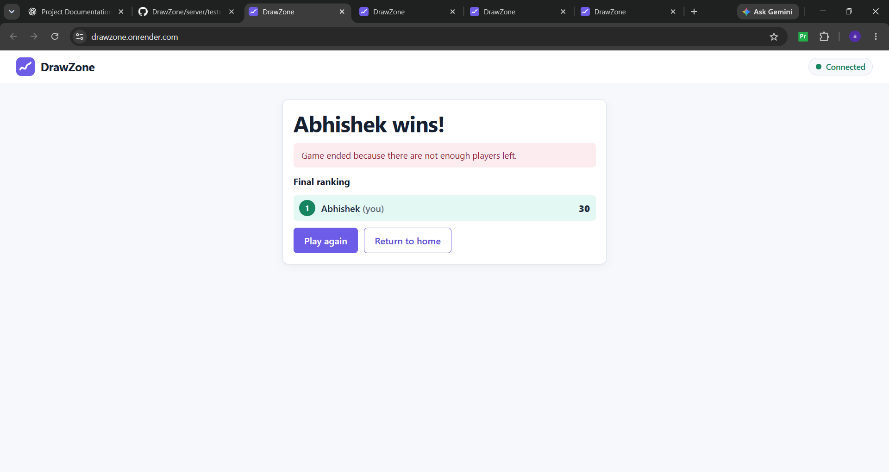

</details>

## Limitations

- No database: rooms vanish when the server restarts; one server process only.
- No accounts: a room code is an identifier, not security. Anyone with the code can join a lobby.
- A dropped connection removes the player from the room (no automatic rejoin).
- No undo, no spectators, no late joining during a game.
- English word list only (50 words).
